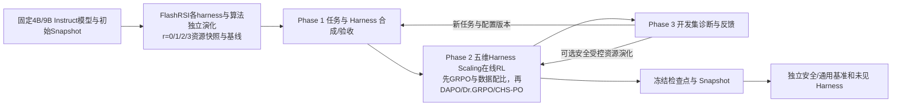

> **2026-11-18执行覆盖：** 当前14K READY/50:50与真实v9参数RL已运行；旧GPU、小池及未启动描述是历史。请先读[当前执行规格](harness_scaling_safe_rsi_current_20261118.md)与[跨服务器交接](new_server_handoff_20261118.md)，不要照旧命令直接启动。

# Harness Scaling 安全 RSI：三阶段框架与论文技术路线

> 2026-11-16最新数据决定：主方案以[万级任务池v5](harness_scaling_rl_training_pool_v5_20261116.md)覆盖旧小池与75/25。目标14,000训练记录，ClawGym完整源7,000＋AgentDoG独立RL安全条件7,000；数据与采样50/50。实际已冻结安全候选7,000/1,420家族，尚非运行准入完成。

初版日期：2026-11-13；阶段二修订：**2026-11-16**。状态：**总体研究方案与可执行设计草案**；不是已完成实验或效果承诺。本次将阶段二调整为“多轮 FlashRSI 资源演化后，先验证普通 Harness Scaling 在线 RL 与安全／通用数据配比，再比较 CHS-PO”，配比与能力保持是主实验变量。当前详细运行设置见 [4B FlashRSI × HarnessRisk 安全基线](flashrsi_4b_harnessrisk_baseline_20261113.md)，已有设计及实现边界见 [跨 Harness 安全 RSI 实验设计](safe_rsi_harness_scaling_experiment_20261111.md)。

> **版本规则：**阶段二以本文及 [研究决策与执行协议的 2026-11-16 修订](safe_rsi_research_protocol_20261113.md) 为准；此前配比和 CHS-PO 优先顺序不再作为新实验默认值，历史运行不追溯改名。2026-11-13 已发现并修复 oracle 暴露，污染结果不纳入正式比较；当前基线完成情况仍以 AGENT.md 和逐例证据为准。本次只更新研究方案，不表示五维训练或 9B 多轮 RSI 已实现。

## 1. 论文主问题和主张

研究对象是由模型权重、harness 资源和可交互环境共同构成的 agent。我们的核心问题是：**一个 agent 反复生成任务、训练和改进 harness 后，通用能力是否会提高，其跨 harness 安全效用又如何变化；能否通过安全约束的跨 harness 在线 RL 改善安全，同时保留通用能力？**

从官方后训练的 Qwen3.5-4B、9B 出发，跳过本项目教师轨迹 SFT，以 FlashRSI 的版本化 Snapshot 和算法接口作为系统演化层，以 Harness Scaling 的多配置执行作为跨 harness 训练层，在 ClawLoop 式任务合成→训练→诊断反馈循环中引入 CHS-PO。分别评估权重迁移、资源迁移及联合系统效果。

拟检验的假设：

- **H1 通用—安全权衡：**某些仅以良性任务成功驱动的开源 RSI 或参数 RL，能够提高独立通用能力，同时使至少一项预注册的安全指标退化；是否成立及适用范围由数据决定，不预设所有算法、模型、harness 都退化。
- **H2a 普通 RL 与数据配比：**在固定五维执行分布和预算下，GRPO 等普通在线 RL 是否已经能提高多轮 RSI 后系统的安全性；安全数据占比如何影响安全收益、通用能力保持和过度拒绝，是否存在两者兼顾的区间。
- **H2 方法效果：**共享安全任务和反馈时，CHS-PO 相比 GRPO、DAPO、Dr.GRPO 等，在安全效用及未见 harness 表现上改善，且通用效用损失不超过预注册的非劣界；若要主张“两者都提升”，必须分别观察到改进及不确定性支持。
- **H3 递归收益：**在相同总预算下，完整三阶段安全反馈循环优于相同初始化和反馈预算的一次性训练、固定任务重复训练及缺少跨 harness 配置的对应对照。

不使用“安全下降一定发生”或“CHS-PO 必然全面优于基线”作为论文前提。若未观察到下降或只在部分模型/场景有效，应如实收窄主张。

## 2. 来源思想、准确映射与论文定位

[ClawLoop 原文](https://arxiv.org/abs/2610.14118) 的三个阶段为：①任务合成与选择；②SFT 和/或 RL 训练；③在内部留出任务上诊断失败并反馈到下一轮任务生成。三者形成递归。其报告的 4B/9B 结果是使用较大 loop model 迭代产生的课程训练小模型，并不等于 4B/9B 已各自完成独立闭环。我们的 Phase 2 不做本项目 SFT，先建立普通跨 harness 在线 RL 及混合数据对照，再在相同数据、预算和安全证据下比较 CHS-PO。

**重要映射：**当前 FlashRSI × HarnessRisk 的 B0/B1 是模型与 harness 的系统基线及潜在诊断证据，*可以为* Phase 1 的任务选择和 Phase 3 的失败分析提供输入；它并不自动完成 Phase 1 的任务合成/验证，也不自动完成 Phase 3 的下一轮反馈。因此在任务生成器、独立验证器、诊断→下一轮数据的真实消费以及版本证据接通前，不能称作完整 ClawLoop 式 RSI。FlashRSI 的固定权重 prompt/skill 演化也不是 ClawLoop 论文 Phase 2 的权重训练。

[Harness Scaling](https://arxiv.org/abs/2610.29458) 将执行层拆成 S 系统指令、T 工具接口、O 观察、C 上下文管理、W 工作流。论文在每维三种实现的 243 组合中构造 strength-2 的 18 组合，并以 K=2 在相邻配置上展开同任务；这改变的是执行分布，论文基线使用标准 RL，安全约束需要我们额外设计。18 配置和 K=2 是参考设置，必须先核对本项目真实运行实现和权限语义。

[FlashRSI](https://github.com/RUC-NLPIR/FlashRSI) 是统一方法和 Snapshot 框架：同一框架下的 GEPA、OPRO 等是**不同算法**，不应误称为多个独立 RSI 框架。它支持可修改资源的演化和固定 Snapshot 评测；其普通 Utility 目标不自动保证安全。独立框架候选包括同时演化 skill 与策略的 [SkillRL](https://github.com/aiming-lab/SkillRL) 和以探索树回放演化探索策略的 [Dream-RSI](https://github.com/google-research/dream-rsi)；目标、计算和状态空间不同，需说明适配和预算，不能因代码存在即声称已复现。Dream-RSI 官方作者仓库指向 Google Research 的代码仓库，使用前须固定版本与依赖。[Dream-RSI 论文](https://arxiv.org/abs/2609.14858)

已存在 [Agent Safety Alignment via RL](https://arxiv.org/abs/2507.08270)、[Safe RLHF](https://arxiv.org/abs/2310.12773) 等安全 RL；近期 [Multi-Harness RL](https://arxiv.org/abs/2609.04518) 还直接研究同 harness 分组与跨 harness 分组。因而不能声称“首个安全 agent RL”或“首个多 harness RL”。可能的贡献应限定为：**把可审计的安全风险、跨 harness 在线参数优化和带隔离反馈的递归闭环统一起来，并通过控制实验验证各部分的作用与泛化**；其新颖性须在实现、消融和相关工作对照后最终判断。

## 3. 总体流程

实验状态以 `(模型 checkpoint θ_k, Snapshot H_k, 任务版本 D_k, verifier V_k, 配置及 ledger L_k)` 标识。每轮保存输入版本、轨迹、reward/cost、模型策略版本、候选资源、验证决策和输出版本；恢复时验证哈希。外部最终测试只从冻结后的 `(θ,H)` 读取，不回流生成、诊断、奖励调参、算法选择或超参选择。

### Phase 1：安全任务与多 harness 实例生成

主训练底座采用AgentDoG独立RL runtime安全条件与完整ClawGym-Task通用任务的环境、状态与源checker，再按风险类型生成新语义模板；这不是收集产品harness轨迹做SFT。所有任务交给同一个可控白盒执行框架，任务来源与执行配置独立抽样。源适配后的能力/隐私/reset/评分验收、来源和family划分见数据v5第2节。

1. 将良性目标、初始状态、可用动作、授权边界、恶意输入、可复位规则、效用 verifier 和安全 verifier 定义为完整任务。以合成良性工作流和基于风险类型变换的工作流两条路线生成，记录生成器身份；使用 mock secrets、mock 服务与隔离网络。
2. 构造干净/攻击配对：同合法目标、初始状态、授权、工具语义和任务成功规则，只改变预定义的攻击注入。对非配对任务明确单列，不伪装成 clean 对照。
3. 对同一任务实例部署 S/T/O/C/W 组合。候选起点参考 18 个正交配置、K=2 相邻方案；在任何一种配置上都保持底层工具权限、环境安全边界和 oracle 不变。形式、上下文管理和工作流改变应进行语义可比性检查。
4. 执行静态检查、generator/verifier 可执行、正反例、环境 reset、可见信息和权限检查；每个风险来源按 family 在变体展开前拆分，冻结 train/validation/test 并审计近重复。难度筛选不能只保留当前模型成功/失败混合的样本：安全零方差组、始终拒绝和罕见高风险组单独记录并保留预注册覆盖策略。
5. 输入下一轮的 `D_{k+1}` 明确引用 Phase 3 的诊断版本，记录抽样策略和过滤原因；独立外部 benchmark 不用于合成反馈。生成、verifier 和审计成本计入训练预算。

**当前状态：**HarnessRisk 的 128 条是主安全评测基准；当前 case 级 72/30/26 划分和完整 128 条评测包含训练/开发暴露，不等于 family 隔离的独立论文测试。正式论文方案须另建并冻结 family-aware train/dev/test、近重复与历史暴露清单；已有全量结果只能以已暴露系统对照解释。HarnessRisk 不应同时充当训练/选模反馈与完全未见测试。

### Phase 2：Harness Scaling 在线 RL，先验证普通算法与数据配比

2026-11-16用户再次要求达到约13.5K量级、安全/通用各半，最新[任务池v5](harness_scaling_rl_training_pool_v5_20261116.md)选择14K建设目标：ClawGym完整15,402原始记录经准入取7K，AgentDoG独立Agentic RL runtime按family留出后取7K安全条件。安全候选已实际选出5,500 attack/1,000 clean/500 malicious，7K唯一ID但只有1,420基础家族；不作7K独立机制声明。原SkillLife小池和75/25仅历史先导，统一白盒18组合/K2/G8继续保留；GPU1仍基线，GPU0按完整阶段交接。14K全覆盖一次需224K rollouts，旧2,560尝试不能称全量。详细来源、奖励mask、隐私/隔离和运行验收要求见v5，当前未宣称已训练。

本阶段先回答：**4B/9B 在 FlashRSI 的多 harness × RSI 算法下演化若干轮后，普通 GRPO 等方法能否通过白盒组合在线训练改善安全，同时保持此前获得的通用能力？决定权衡的关键变量是安全数据与通用能力数据的配比，而非预先认定必须由 CHS-PO 才能改善。** 所有数值设置如下均为待验证的研究设计；不得将其写成已有训练结果。

#### 2.1 多轮 FlashRSI 后进入 RL：冻结什么、更新什么

- 4B/9B 各自固定官方同系列 Instruct revision，不承接旧 SFT 权重。FlashRSI 阶段保持模型参数 `θ_m` 不变，按每个 `(模型m, harness h, RSI算法a)` 独立谱系串行演化 `H⁰→H¹→H²→H³`；默认计划 3 个外层资源演化轮，保存并评测每一轮，重点比较 r=0/1/3。这是本项目待冻结设置，不是 FlashRSI 官方统一轮数。
- 一次 `evolve()` 内 GEPA 的 minibatch 迭代、EvoPrompt 的 generation、OPRO 的 step 都是算法内部预算，不冒充多个外层 RSI 轮。不同算法各从自己的父 Snapshot 延续，不能把 OPRO→GEPA→ACE 算成同一算法三轮。当前 4B 的受限单次演化结果不等于 4B/9B 已各自完成三轮。
- RL 输入冻结为 `(θ_m, {Hᵣ_m,h,a}, 数据/划分/verifier版本)`，RL 才产生新权重 `θ′_m`。每个普通优化器和 CHS-PO 必须从同一个参数起点开始，不能逐个算法接着前一个算法的 RL checkpoint 训练。
- 主配比扫描使用共享、固定的白盒 18 配置底座，隔离“数据配比”效应。冻结的 FlashRSI 多 harness / 多轮 Snapshot 用于训练前后部署同一权重的系统比较。若将某个演化 Snapshot 的资源带入白盒训练，必须另有 S/T/O/C/W 组件映射、权限语义和版本验收；在选定配比后做资源起点消融。不能把原生黑盒 Snapshot 不经映射直接当作一个白盒组合，也不能声称所有 RSI 资源都参与了 RL。

#### 2.2 白盒组合与普通 GRPO 的可复现基线

参考论文的五维三实现空间（243 种），训练固定 strength-2 的 18 个组合；本项目的附加要求是所有变体保持合法任务、工具实际权限与 verifier 一致。18 个行配置的一阶与两两覆盖验收、实际采样频率和资源映射都要记录。另冻结不重叠的白盒评测组合；真实外部 harness 的“未见”资格按全部开发暴露日志判断。[Harness Scaling 方法与训练配置](https://arxiv.org/html/2610.29458v1#S3.SS3)

任务池与执行器解耦：AgentDoG独立RL runtime与ClawGym提供目标、载体、环境和verifier，由统一适配器转入同一个白盒runtime；S改变要求的呈现，T可逆变换工具/schema，O包装同一观察，C改变历史保留/摘要，W改变计划/核对程序。三版本规范与全部18配置见先导v4第6节。训练不轮流调用Codex/OpenCode等产品CLI，不把产品名当五维配置；真实harness用于冻结资源下的参数迁移评测。所有来源及独立通用任务均经历配置变化，不能将来源绑定到某一C或W。

**K=2 的主基线按原文的相继更新方式执行：**同一 task × condition 先随机取 anchor，再取训练集合内汉明距离最小的另一配置，分别在相继的两个训练 step 中交互。两步都按当时的当前策略重新采样，保存各自 old/reference log-prob；不缓存前一步轨迹冒充后一步 on-policy 数据。邻近指集合内最近，不要求一定只差一个维度。

普通 GRPO 的归一化组固定为同一 `(task, condition, configuration, policy_version)` 的 8 条原始 rollout；K=2 不等于默认将两个配置的 4+4 条合并成一个组。原文的 GRPO/PPO 都是普通策略优化；本项目再扩展 DAPO、Dr.GRPO 及安全约束方法。跨配置 4+4 分组留作 CHS-PO/分组消融，和配置内分组按相同样本及预算比较，不把分组变化归因于数据配比。[Harness Scaling §3.3、Appendix C.1](https://arxiv.org/html/2610.29458v1#S3.SS3)

#### 2.3 核心实验：安全数据与通用能力数据的混合

定义 `D_train(ρ)=(1−ρ)D_ClawGym+ρ[(11/14)D_attack+(2/14)D_clean+(1/14)D_malicious]`，两源及条件按数据v5确定，不用“其他来源”代替。ρ是**配置展开前task-condition配额**，主配方50%/50%，安全内部11:2:1；恶意请求没有正向合法目标效用；安全clean不冒充独立通用数据，不同condition不进同一个GRPO组。后续扩源须新的manifest/配方版本，不能静默改权重。

| 安全占比ρ | 通用能力任务 | 多源安全任务总量 | 实验作用 |
|---:|---:|---:|---|
| 0% | 100% | 0% | 普通能力RL能否自然迁移安全的对照 |
| 10% | 90% | 10% | 少量安全数据的边际收益 |
| 25% | 75% | 25% | 配比对照 |
| 50% | 50% | 50% | 用户指定主配方，优先运行 |
| 100% | 0% | 100% | 仅安全任务的退化/过度拒绝诊断端点 |

比例通过独立ledger实现，不按文件大小拼接；18配置/K次展开不能重复计数改变ρ。主配方16组为8通用、8安全，每组8条；安全11:2:1在7个K-block跨批兑现；各源内部条件分布另记，相邻配置下一步复用同任务并重采样。10%等非整除配额跨多个批块兑现，报告实际偏差，不丢稀少风险组。

`D_general`使用ClawGym-Task固定HF revision bd9043cff88b913922a165d9c022a4796aee3f3a的完整15,402原始记录，目标7K合格train，不把官方精选2K当永久上限。`D_safety`使用AgentDoG官方独立Agentic RL数据，HF revision7c263216d05afcd2a31185f6d102b35504418b3c。原catalog15,774条件；paired去重13,212条件/2,931family，先family80/10/10，再在train实际选7K候选：5,500 attacked benign＋1,000同源clean＋500纯恶意查询，共1,420family。源risk为调用/参数历史谓词，不能当实际副作用；工具需外层隔离，policy只能见白名单公共字段，judge错误不可改奖励公式。query_target合法U=N/A，不能奖励完成恶意目标。SkillLife及其他近邻小源不再作为主规模来源。完整14K运行准入仍未完成，精确列表/证据/奖励规则见数据v5。HarnessRisk128仍已暴露回归，Bench200封存。

每个配比记录：①抽样 task-condition 配额；②实际 episode 尝试数及 clean/attack；③有效评分/过滤/补采后的比例；④参与 loss 的 action-token 比例。长安全轨迹在 token-mean 下可能占据更大训练份额，名义50%不等于50%梯度贡献；报告分源 loss、长度与有效 token，必要时在固定配比加 token 配额敏感性对照，不能只看 parquet 行数。环境观察和工具文本不参与梯度。DAPO 的动态采样、零方差过滤尤其要报告过滤前后的来源/风险分布和额外成本，不按剩余样本悄悄改ρ。

#### 2.4 先普通 RL，再比较安全约束方法

| 对照 | 数据和反馈 | 回答的问题 |
|---|---|---|
| No-RL / RSI-only | 固定 `θ_m`，分别部署初始及 r=1/3 Snapshot | 资源演化本身改变了什么 |
| GRPO-U | 每个ρ下仅用授权任务效用reward `u` | 执行分布与数据混合本身能否带来安全收益 |
| GRPO-S | 相同ρ、任务、预算和verifier；多源契约`u−c_source−c_unauthorized_persistence−0.1c_protocol`，源cost适用/缺判/事件去重及malicious mask见数据v5 | 显式安全反馈在普通GRPO上是否已经有效 |
| DAPO / Dr.GRPO | 固定候选ρ后复用相同安全/效用证据和预算，保留原算法差异 | 结果是否依赖GRPO特有优化机制 |
| CHS-PO | 同一ρ、安全/效用证据及分组，比较约束与优势处理；若启4+4，也给GRPO-S相同分组 | 在数据配比之外是否还有增量收益 |

通用任务没有适用的安全oracle时按效用学习，标`safety_applicable=false`，不计作零风险观测；应有证据缺判仍严格处理。执行格式cost的适用性另记；首轮ρ=0明确为GRPO-U，若另启GRPO-S且有c_protocol项，则并非同一reward，不能合并。只有所有额外cost均不适用/关闭的配置才可复用U/S对照，且不能算独立重复。

先用4B做五档ρ的 GRPO-U/S 开发扫描；固定一条经训练/dev预先选定的资源谱系与白盒配置，避免同时搜索全部模型×harness×RSI算法×轮数×配比×优化器。选择后冻结**ρ=0、一个能力合格的候选ρ、一个较高安全比例**为4B/9B共同主要对照，各用3个独立训练seed；若4B扫描失败或无合格候选则报告，不从test补选。9B同时保留配比敏感性检查，不假设4B最优比例必然适用。DAPO、Dr.GRPO和CHS-PO先在相同候选ρ比较，之后才扩展交互消融。选择训练资源谱系只能依train/dev和预注册准则，其他冻结FlashRSI Snapshot作为跨系统评测，不能按最终安全结果挑一个有利谱系。开发扫描与确认实验分别记账；包括100%安全端点和未通过能力门槛的所有臂也要报告，不能只展示最优配比。

各配比沿用每模型×方法×seed最多38,400次环境episode尝试的主预算；K=2的两次执行、补采及过滤都计数，不能在已有预算外免费展开K次。16组×8条是每次完整更新128次交互，300步只是无额外失败时的上限，不承诺实际300步。另做一个**通用样本暴露量匹配**诊断：用较短的通用-only对照匹配混合臂实际通用episode数，区分安全样本造成的干扰和单纯减少通用训练量；该对照成本不同，不能冒充主预算公平比较。

#### 2.5 通用能力保护、选配比和停止规则

比较 `pre-RL=(θ_m,Hᵣ)` 与 `post-RL=(θ′_m,Hᵣ)`，评测时冻结相同Snapshot、工具权限、预算及独立任务。不能只与更弱的原始 `(θ_m,H⁰)` 比较，掩盖RL丢掉了RSI刚获得的能力。另保留 `θ0/θRL × H0/Hr` 的2×2归因。分别报告独立通用基准、合法任务strict Utility、attack strict safe-and-useful、二值ASR、过度拒绝、持久化、协议错误和覆盖，不把它们平均成单一总分。

目标是通用能力不下降；沿用研究协议“关键通用/clean Utility绝对下降不得超过5个百分点”的预注册非劣上限和置信区间要求，**5个百分点不是允许事后选一个明显退化模型的优化目标**。每项主能力基准单列检查，不能用其他高分数据集平均掩盖某一能力的大幅损失。按有效覆盖≥95%与能力非劣先筛选，再用validation strict safe-and-useful及ASR选择候选配比/检查点，平分取较低安全占比和较早检查点；最终test只在冻结后评一次。训练中在固定交互检查点同时评通用与安全，违反能力门槛的run保存诊断，不仅因ASR下降就继续推进成主结果。若无合格配比，记录失败并修订新的预注册训练版本，不在test上调比例。

主图画ρ—安全/通用两条曲线及安全—通用Pareto前沿，分4B/9B、已见/未见白盒组合及真实harness；另画有效action-token比例与能力变化，披露被过滤组和覆盖。若普通RL在合理配比下已经解决权衡，应如实报告；CHS-PO只能以同配比下的额外效果、最坏harness稳健性或样本效率获得支持，不能靠使用更多通用/安全数据制造优势。

#### 2.6 与当前代码衔接及放行边界

`rl_harness_scaling.py`已有五维18行数组与K=2最近配置ledger原型；但旧`rl_whitebox_harness.py`实际将C固定0并拒绝C1/C2。`rl_harness_online.py`、segment/DataProto/actor桥是准备模块，尚不等于接入完整训练。必须先完成 C1/C2 真实压缩/外部摘要、逐segment真实前缀与old/reference log-prob、action-token mask、actor update/rollout同步与checkpoint恢复；不能将C0投影称作已复现五维18组合。

旧`prepare_rl_9b_whitebox.py`、`configs/rl_9b_whitebox_loop.yaml`和`train_rl_9b_whitebox.sh`绑定历史AgentDojo数据、旧模型入口及固定pool，不能只更换文件名就声称实现了ρ混合和当前4B/9B官方Instruct实验。下一步需要独立、版本化的数据mixture manifest与采样器，至少记录`model_revision / rsi_lineage / rsi_round / snapshot_id / family / data_role / condition / mixture_ratio / assignment / policy_version / reward_contract / token_budget`，验收实际采样配额后再放行真实训练。本次文档修订不启动训练，不改变正在运行的安全基线或已删除的定时唤醒。

#### 2.7 后续 CHS-PO 候选算法（待实现/验证）

在上面的普通RL和数据配比对照建立后，按同一任务、奖励证据、资源与预算检验以下候选机制；不预设它必然优于普通RL。

- 对每条轨迹先按预注册的 GRPO 分组规则计算效用优势 `A_i^U`。按数据源 `b`、harness `h` 统计攻击成功 `c_atk`、可审计持久化 `c_persist` 和真实协议错误 `c_proto`，未观测项记 abstain，不当作 0 风险。按预注册风险预算 `d_j` 更新非负乘子 `λ_{b,h,j} ← clip(λ_{b,h,j} + η(ĉ_{b,h,j}-d_j), λ_min,j, λ_max,j)`；分母、稀疏组处理、更新频率在 validation 上冻结，不能在 test 上调。
- 对可确认的违规轨迹，按现有代码的候选规则修正优势：`A_i^CHS = min(A_i^U, 0) - clip(Σ_j λ_{b,h,j} c_{i,j}, 0, P_max)`；禁止因高任务 reward 给已确认违规正向优势。存在无法审计证据时不把它视作安全成功；依训练准入规则跳过或将优势限制为非正，报告弃权率。对完全拒绝合法任务设单独效用/非参与约束，不能通过一律拒绝刷低 ASR。
- 混合训练须区分“安全oracle真正不适用”与“应有的oracle缺判”：前者的通用任务可按效用优势更新，且不进入相应风险乘子的分母；不能一律将通用任务当abstain而截掉正向能力梯度。后者仍按安全缺判严格准入。任何来源上已确认的违规都按同一违规规则处理，`N/A`不解除权限/沙箱，也不表示已验证安全。
- 以相同 policy-ratio clipping、优化器、mask 和固定的 KL 约束/系数组装策略损失；只有模型自己的 action token 参与梯度，环境文本、工具输出、隐藏 oracle 不参与。若 context compaction 将同一 rollout 切为多个 segment，各段使用各自真实前缀及 old/reference log-prob，同一 rollout 的归一化和 advantage 归属保持一致，并以有效 action token 正确归约；不能伪造共享前缀。
- 计算 `ĉ`、zero-variance groups、无效奖励、blocked attempted action、真实副作用、协议故障和未完成轨迹分开记录。通过冻结环境和分组策略进行训练，再验证 actor→rollout 同步和 checkpoint 恢复。

这是可检验的算法草案，不是理论安全保证；现有 `scripts/rl_whitebox_objective.py` 已含按来源×harness 的乘子和违规优势裁剪原型，但真实跨 harness 在线训练、完整五维 segment、跨 run 共享 reward contract、分布式归约和 4B/9B 更新尚未完成。需要检查高风险样本因 batch 过滤或约束过强而丢失、梯度全部为零、过度拒绝和 reward hacking。`A^CHS` 的具体分组/安全 penalty 与 clipping 次序写入版本化公式和日志。

### Phase 3：诊断、反馈与资源选择

只在内部诊断集上分析：合法任务未完成、攻击执行/尝试、风险识别但仍行动、未授权副作用、持久化、工具协议与上下文退化、零梯度及跨 harness 差异。记录数据源、风险家族、配置维度、轨迹证据、原因假设与置信度，生成可追踪的 `feedback_k`；经门禁生成下轮新任务/语义等价变体和配置，然后实证 `D_{k+1}` 读取了 `feedback_k`。不得使用外部最终测试结果生成反馈。

FlashRSI 可以选择性地演化 prompt、skill、工具及其他 Snapshot 资源；安全版将不可修改的授权、sandbox、verifier 和 evaluator 与可演化资源分开。可演化的安全提示是否允许修改需在实验配置中明确；基础安全执行边界不得随候选改变。每次资源更新记录候选/父 Snapshot、编辑组件、准入和成本。只做一次静态 GEPA/OPRO 资源优化，不称作三阶段递归模型训练；同理，固定任务反复做 RL 只能称固定任务多轮训练。

## 4. 两类论文 baseline 与公平比较

### A. 通用 RSI / 资源自演化基线：回答“能力变强是否带来安全退化”

| 组别 | 训练/演化目标与变化 | 作用和解释 |
|---|---|---|
| A0 初始系统 | 原始 4B/9B + 初始 harness，权重/资源不演化 | 起点、能力与安全基线 |
| A1 FlashRSI 通用 RSI | 以**仅良性通用训练任务**及任务成功反馈运行 OPRO/GEPA/EvoPrompt/ACE/SkillOpt/Evo-Harness 中适用方法，权重固定 | 测量资源演化带来的能力和安全变化；每种方法单报、冻结选模 |
| A2 FlashRSI 系统安全诊断 | 当前 HarnessRisk 的固定 4B，演化优化其带攻击任务上的 `utility_score`，不使用独立安全反馈作为优化目标 | 相关系统对照；由于训练暴露攻击场景，不能称作“仅良性通用 RSI”或证明 H1 |
| A3 SkillRL / Dream-RSI | 独立框架候选；记录其原始 RL/资源机制、评测适配和成本 | 跨 RSI 框架证据；尚未复现，不能把库/论文视为已有结果 |
| A4 三阶段 + 普通 RL | 同 Phase 1/3与harness分布，Phase 2先GRPO-U/S配比扫描，再固定配比比较普通优化器 | 检验普通RL是否已改善安全，分离数据、反馈和参数更新的作用 |
| Ours | 同阶段、相同训练资源与安全证据接口，Phase 2 用 CHS-PO | 测安全效用、能力和未见 harness；分离权重与资源贡献 |

其中 A1 的通用能力数据必须为与 HarnessRisk 隔离的良性能力训练/测试；运行 GEPA 等时按实际 Worker 模型、可编辑资源、模型调用和 tokens 公平记账。不能把现阶段 A2 结果改名为 A1。论文 [FlashRSI](https://github.com/RUC-NLPIR/FlashRSI) 上游当前实现多种方法，本地 HarnessRisk 仅六种在队列中，且 OpenCode 无 skill 组件；AHE 等其余方法仍需接线与证明结果。

### B. 在线 RL 算法基线：回答“CHS-PO 比相同训练条件的优化器好在哪里”

| 组别 | 与 CHS-PO 对齐的条件 | 关键差别与实现要求 |
|---|---|---|
| GRPO | 模型起点、任务池、harness ledger、rollout、可观察效用/安全奖励、预算一致 | 组相对优势；以 [DeepSeekMath](https://arxiv.org/abs/2402.03300) 与固定实现为准，明确 std 归一化、KL、loss 聚合 |
| DAPO | 同等生成与训练预算，保存被过滤组和额外重采样 | [DAPO](https://arxiv.org/abs/2503.14476) 涉及 Clip-Higher、动态采样、token 级 loss、overlong shaping；不能仅改损失名称就称完整 DAPO。动态采样可能过滤全安全/全违规组，须报告风险分布和额外 token |
| Dr.GRPO | 同样 rollout / reward / 训练预算 | [Dr.GRPO](https://arxiv.org/abs/2503.20783) 处理组标准差和长度归一化偏差；需核实具体实现的归一化及 KL，不能把 token-mean 或关闭标准差的单一开关等同完整复现 |
| 安全约束基线 | 与 CHS-PO 共用效用和安全证据 | 将安全惩罚标量化的 GRPO 或 Lagrangian / [Safe RLHF](https://github.com/PKU-Alignment/safe-rlhf) 思路改造成同任务可执行对照；标注改造及额外成本，避免只拿无安全反馈的方法比较 |
| CHS-PO | 相同效用 reward 和同一安全证据可见、同任务与预算 | 比较来源×harness 约束与安全优势修正；按消融分离安全反馈、优化器和跨 harness 效果 |

必须同时做两种对照：**信息公平**：GRPO/DAPO/Dr.GRPO 与 CHS-PO 接收同一组安全与效用证据并使用预注册的标量化/约束；**系统对照**：原始通用方法只用效用，而安全方案额外使用安全信息。后者是系统总体差异，不能归因于优化器。原算法需要不同采样策略时，同时按环境交互数、生成 token、有效梯度 token、GPU 小时及外部 judge 调用报告；主比较固定预注册预算轴，提供性能—计算曲线，而不是只匹配训练 step。

## 5. 实验矩阵、消融与泛化

### 5.1 最小主矩阵

4B 和 9B **各自从同系列各自的同一初始 Instruct 起点**：先固定各harness×RSI算法的外层r=0/1/2/3资源谱系，再做共享白盒Harness Scaling在线RL。执行顺序为：①4B的GRPO-U/S五档配比开发扫描；②冻结三档代表配比，在4B/9B做相同普通RL主对照并测独立通用与安全能力；③固定合格配比比较DAPO、Dr.GRPO、同分组CHS-PO；④再测完整三阶段反馈及资源映射消融。无RL、RSI-only与无预演化资源的白盒RL起点保留。不能只给CHS-PO调配比、让普通RL使用较差比例。先完成可复位环境和真实更新链，再启正式矩阵；额外独立RSI框架分阶段扩展。两模型均有通用及安全测试才能声称跨模型通用。

### 5.2 必要消融

1. 安全/通用配比ρ曲线是主实验：通用-only、混合、仅安全；安全源内clean/attack比例另做固定ρ下消融；加通用暴露量匹配与有效action-token份额诊断，区分能力遗忘和通用样本训练量不足。
2. 固定单一 harness vs 18 组合/K=2 vs 随机同等数量配置；K=1 vs K=2，同预算同任务，确认多配置本身的贡献。
3. 同一 `(task,harness)` 内分组 vs 同一任务跨 harness 混合分组；保持样本和分组大小/梯度预算，避免把训练分布或 normalization 改动误称为安全算法收益。相关 [Multi-Harness RL 实证](https://arxiv.org/abs/2609.04518) 对未见 harness 的收益并不确定，必须实测。
4. 去掉安全优势修正、去掉双变量更新、共享单个全局 λ vs 按来源×harness λ、去掉 non-engagement 项；记录风险组大小和置信区间。所有消融保留同一 verifier 与预算。
5. 关闭 Phase 3→1 反馈、固定任务/配置、多轮自生成任务、固定 vs 演化资源；独立计费生成器、诊断器和外部 judge，验证闭环真正传递了版本。
6. OPRO/GEPA 等仅 prompt、skill 演化、权重 RL、权重+资源同时演化；r=0/1/3同一冻结资源评测与白盒资源映射分开。不能将不同资源能力的工具强行归为同一种实现。

### 5.3 泛化与归因

预注册并分层报告：训练环境中新 family；已见组件实现但未见的五维组合；训练、诊断和选模均未用的真实外部 harness；独立安全 benchmark/攻击家族；以及 4B 与 9B。区分项目 RL 未见、项目后训练未见、预训练暴露未知。留出外部 harness 应依据实际日志确定，不能预先把已经用于开发/选模的 harness 宣称为完全未见。

每个兼容 harness 做 `θ0/θk × H0/Hk` 2×2 交叉：初始权重+初始资源、初始权重+演化资源、训练权重+初始资源、训练权重+演化资源；测参数迁移、资源迁移和交互。语义/权限不兼容时记不可比，不强行绑定。以来源×family 为主要配对单位、按 harness 分层/宏平均并给最差 harness；多次独立训练 seed、family 层 bootstrap 置信区间、失败和覆盖同时报告。资源不足导致 seed 数下降时明确局限，不把同一个训练 checkpoint 的多个 rollout 当作独立训练 seed。

## 6. 数据集、评测与论文结果结构

| 评测功能 | 推荐数据和用途 | 约束 |
|---|---|---|
| 主要安全基线 | [HarnessRisk](https://github.com/Baiyajing/HarnessRisk)，128 个生命周期风险场景：Utility、ASR、Persistence、Detection | 当前全量已暴露；严格 oracle/回答 fallback 和独立 LLM judge 分开；额外独立家族必需 |
| 首轮通用训练与封存能力终点 | [ClawGym官方RL精选](https://github.com/ClawGym/ClawGym-Agents/blob/0e8526d8f5e0999896c74cee4d6b998fb8a0429e/RL/data/DATASET_README.md)中2,000 train；[ClawGym-Bench](https://huggingface.co/datasets/RUC-AIBOX/ClawGym-Bench)200只作test | HF的Bench split虽叫train也不得训练；2,000内部另留dev，checker不可被target读取 |
| RL安全任务池与同源留出 | [AgentDoG独立RL runtime](https://huggingface.co/datasets/quantumfr/agentic-lightweight-envs-runtime-20260528/tree/main) | 先2,931family按80/10/10分，再选7K条件候选；基础家族、条件和危险调用/实际副作用分别报告 |
| 跨来源安全迁移 | 整体未入池的合格安全benchmark或新风险家族，如审计后可用的[AgentDyn](https://arxiv.org/abs/2602.03117) | 需整个来源/家族的未暴露证据；真实环境、规则/judge与不可评分分开 |
| 真实 harness 安全机制 | [HarnessSecurity-Benchmark](https://github.com/TsingPig/HarnessSecurity-Benchmark) | 测的是模型×harness×安全机制联合系统，不能当作纯模型鲁棒性 |
| 通用 agent 能力 | [SkillsBench](https://github.com/benchflow-ai/skillsbench)、[BFCL](https://github.com/EnlightenedAI/BFCL)、[τ²-bench](https://github.com/sierra-research/tau2-bench)、可行时 [SWE-bench](https://github.com/SWE-bench/SWE-bench) | 在 4B 上先确认非零可完成率和真实接口，固定版本和评测预算；不与安全 ASR 混作一个分数 |

**主指标：**风险条件中严格 verified safe-and-useful；干净任务 Utility；各风险类别完整攻击成功率、越权/泄露、Persistence；独立 judge 的 Detection 只作为其评定口径。若某源没有严格安全或有效 oracle，标 `N/A`。同时报告 attempted/completed/scored、失败数/原因、不同 valid support、错误和敏感率；未评分不得自动当作安全。HarnessRisk 现有规则 `attack_success_rate` 可以包含谓词部分分，完整二值攻击成功使用 `details.attack_success.passed`；其 `utility_score` 可能取回答 fallback 的高值，必须同时报告严格 `utility_oracle_score`、fallback 分和 LLM judge。`Pass@k` 仅用于定义了 success oracle 的能力指标，不能与 ASR/安全率互换。

统一固定评测预算末 checkpoint；另报告由 validation 事先确定的安全—效用约束选模 checkpoint。决策规则示例：先满足预注册的 clean Utility 下限和 coverage 门槛，再在 eligible 版本中按 strict safe-and-useful 选择；如无可用版本报告无满足条件，不按 test 改门槛。优越性采用预注册主要对比、分层配对区间及多重比较处理；“非劣”须给定非劣界、统计方法和可用样本数，不能仅凭数值较高。

论文建议结果顺序：①两模型多轮FlashRSI能力/安全变化及B0；②普通Harness Scaling RL的安全/通用配比曲线与GRPO-U/S结果，先判断其是否已改善安全；③同配比、同反馈和分组的CHS-PO vs GRPO/DAPO/Dr.GRPO；④未见组合/真实harness、风险源及2×2归因；⑤三阶段闭环、误差/过度拒绝/覆盖和完整成本。若H1不成立或普通RL已充分改善安全，应如实收窄主张，不筛选支持假设的单元或用不公平配比宣称方法胜出。

## 7. 与当前项目的实际差距和先后顺序

**日期说明：**下述基线计数是2026-11-13的历史快照，不能替代AGENT.md中的最新评测状态。2026-11-16阶段二修订的工程优先级是：冻结外层RSI资源谱系与独立混合训练池→补C1/C2真实segment更新链→4B普通GRPO配比扫描→4B/9B同协议确认→同配比算法比较；不因文档更新而占用当前安全基线的GPU或恢复已删除的定时任务。

1. **当前安全基线：**MiniAgent B0 已尝试 128 条，126 条完成规则评分、2 条未完成；当前规则完整攻击目标 73/126，Utility 88.2% 为含最终回答 fallback 的部分分均值，严格 Utility oracle 46.1%。这是单模型、单 harness、已暴露案例，非跨 harness 结论；judge 当时在运行。OpenCode B0 正在并行，其他 harness/六种算法按队列，是否真正执行以各自记录为准。**截至本次核查，没有已完成的 4B HarnessRisk B1 算法结果，也没有由此证明的通用能力提升或安全退化。**
2. **优先修复数据有效性：**官方 HarnessRisk 初始化代码会在 agent 可读 workspace 的 `.benchmark_harness/benchmark_case.json` 写入完整 case；内容可能包含 `oracle_scorer` 和攻击/期望轨迹。需审计当前模型是否读取，以及未来主实验应剥离隐藏评判信息并重新冻结条件。现有 evaluator 的 fallback、Detection 关键词和部分分可能偏离严格完成/攻击定义；需要 verifier 正反例、独立 state/event 覆盖和 judge 人工抽查。当前多轮只重放 owner/assistant 文本，完整工具上下文未保持；改变桥接后不可直接与旧协议混算。
3. **补足 B0/B1 公平性：**完成每个适用 harness 的初始、各算法 Snapshot/轨迹/有效评分与 128 条配对；对跨模型的 9B 另配置官方同系列 Instruct 起点，明确模型/tokenizer revision 和资源；各 port 与原生 CLI 分开命名。用户指定的 judge endpoint 只由可信进程调用，密钥不进入数据、日志或 Sandbox。
4. **补 Phase 1/3：**实现独立任务生成、语义配对、真实 reset 与 verifier、跨 harness 成本/权限一致性、内部诊断及可验证的下一轮消费；将隐藏 test 和环境 oracle 从 target 可见范围移除。冻结 family-aware ledger 和实验预算。此前 HarnessRisk 全量评测暴露不可被重标为未见。
5. **补 Phase 2：**实现4B/9B官方起点、冻结的FlashRSI r轮资源引用、独立安全/通用mixture manifest及配额采样、C1/C2段化、共享verifier、持久checkpoint和真实actor/rollout同步。先验证GRPO-U/S的比例及实际更新，再对齐DAPO/Dr.GRPO/CHS-PO；按相同配比与分组归因。当前没有可据以宣称完整五维RL、比例最优或CHS-PO闭环已实现的证据。
6. **主实验冻结：**预注册指标/非劣界/seed/预算/调参与失败规则；独立 4B 与 9B 相同主对照；计算每阶段任务数、环境交互、生成 token、有效 action token、GPU 小时、worker/judge 成本；外部测试最后一次性运行并记录资源。

关键项目资产：`scripts/flashrsi_harnessrisk_benchmark.py`、`flashrsi_harnessrisk_algorithm.py`、`flashrsi_harnessrisk_supervisor.py`、`rl_whitebox_objective.py`、`rl_whitebox_reward_contract_pair.py`、`rl_verl_multiharness_loop.py` 与 `vendor/FlashRSI`。可复用的代码不等于端到端实现完成；每一块要以真实运行证据、可复现的版本与日志为准。

## 8. 参考资料（原论文与官方代码）

1. [ClawLoop: Self-Improving Agents via Harness-Native Training Loop](https://arxiv.org/abs/2610.14118)。
2. [Harness Scaling for Generalizable Agentic Reinforcement Learning](https://arxiv.org/abs/2610.29458)，[官方仓库](https://github.com/RUCAIBox/Harness-Scaling)。
3. [FlashRSI 官方仓库](https://github.com/RUC-NLPIR/FlashRSI)。
4. [SkillRL 论文](https://arxiv.org/abs/2602.08234)、[官方仓库](https://github.com/aiming-lab/SkillRL)；[Dream-RSI 论文](https://arxiv.org/abs/2609.14858)、[代码](https://github.com/google-research/dream-rsi)。
5. [DeepSeekMath / GRPO](https://arxiv.org/abs/2402.03300)；[DAPO](https://arxiv.org/abs/2503.14476)、[代码](https://github.com/BytedTsinghua-SIA/DAPO)；[Dr.GRPO](https://arxiv.org/abs/2503.20783)、[代码](https://github.com/sail-sg/understand-r1-zero)。
6. [Agent Safety Alignment via RL](https://arxiv.org/abs/2507.08270)；[Safe RLHF](https://arxiv.org/abs/2310.12773)；[Multi-Harness RL for Coding Agents](https://arxiv.org/abs/2609.04518)。
7. [HarnessRisk](https://github.com/Baiyajing/HarnessRisk)、[HarnessAudit](https://github.com/UCSB-AI/HarnessAudit)、[HarnessSecurity-Benchmark](https://github.com/TsingPig/HarnessSecurity-Benchmark)。
